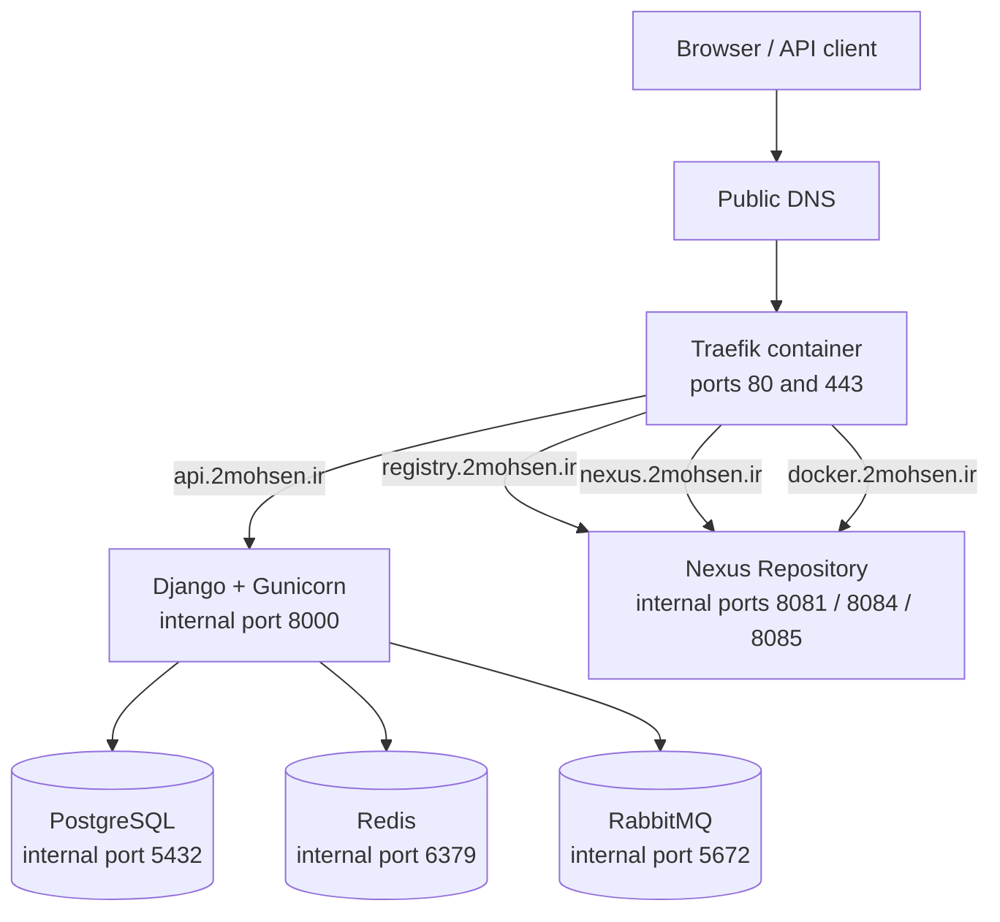

# Infrastructure DevOps Project

Infrastructure and deployment configuration for the **DevOps Django application**. This repository brings together the Docker Compose definitions for the application stack, Traefik reverse proxy, and Sonatype Nexus Repository.

---
> **This project was developed as part of a student's academic work in 2026.**
---

> **Application source code:** The Django/Python code is maintained separately in [`2mohsen/app-devops-project`](https://github.com/2mohsen/app-devops-project). This repository focuses on infrastructure and deployment configuration.

## Related repositories

- **Infrastructure and deployment:** [infrastructure-devops-project](https://github.com/2mohsen/infrastructure-devops-project)
- **Django application source:** [app-devops-project](https://github.com/2mohsen/app-devops-project)

## Overview

The root `compose.yml` includes three Compose files:

```yaml
include:
  - ./traefik/docker-compose.yml
  - ./nexus/docker-compose.yml
  - ./application/docker-compose.yml
```

This brings the services together into one deployment. The main components are:

- **Traefik** — reverse proxy, HTTP/HTTPS entry points, Docker-provider routing, and ACME certificate management.
- **Nexus Repository** — hosts and serves repository endpoints, including Docker registry endpoints.
- **PostgreSQL** — persistent relational database for Django.
- **Redis** — cache or application-side Redis service.
- **RabbitMQ** — message broker used by Celery/background tasks.
- **Django + Gunicorn** — runs database migrations and collects static files at startup, then serves the Django application over port `8000` internally.

## Architecture



All services are attached to the shared Docker network named `web_net`, allowing service-to-service communication by Compose service name. Traefik uses Docker labels to discover and route to the application and Nexus.

### Request flow

1. A client requests a public hostname such as `api.2mohsen.ir`.
2. DNS resolves the hostname to the server.
3. Traefik receives HTTP/HTTPS traffic on ports `80` and `443`.
4. Traefik routes the request to the appropriate internal service based on its hostname and labels.
5. Django connects to PostgreSQL, Redis, and RabbitMQ using their internal Docker DNS names.

## Container inventory

| Service / container | Purpose | Internal endpoint | Persistent storage |
|---|---|---|---|
| `traefik` | Reverse proxy, routing, TLS certificates, access and application logs | `:80`, `:443`; dashboard/API uses `:8080` | Host-mounted ACME data and Traefik configuration |
| `nexus` | Repository manager and Docker registry endpoints | `8081`, `8084`, `8085` as configured by Traefik labels | `nexus-data` |
| `postgres` (Compose service `db`) | Django relational database | `db:5432` | `pgdata` |
| `redis` | Redis service | `redis:6379` | `redis-data` |
| `rabbitmq` | Message broker for asynchronous work | `rabbitmq:5672` | No named volume is declared in the current Compose file |
| Django (Compose service `django`) | Django application served by Gunicorn | `django:8000` | `static_volume`, `media_volume`, plus a bind mount for application code |

The Compose configuration references images from `docker.2mohsen.ir` for PostgreSQL, RabbitMQ, and the Django backend.

## Docker network

### `web_net`

The Compose files configure their default network to use the shared network name `web_net`.

**What it does:**

- Connects Traefik to the services it routes to.
- Allows Django to reach dependencies by service DNS names, such as `db`, `redis`, and `rabbitmq`.
- Allows Traefik to select the correct network for upstream connections using the `traefik.docker.network=web_net` label.

The application services do not publish their database, Redis, RabbitMQ, or Gunicorn ports to the host in the current Compose definitions. Traefik publishes host ports `80` and `443`.

> The network must be shared by the Compose projects. If you run the individual Compose files separately rather than through the root include file, verify that Docker has created/reused the same `web_net` network.

## Volumes and persistent data

Named volumes preserve state across container recreation. The following named volumes are declared in the Compose files:

| Volume | Used by | Container path | What it stores |
|---|---|---|---|
| `pgdata` | PostgreSQL | `/var/lib/postgresql/data` | Database files |
| `redis-data` | Redis | `/data` | Redis data, subject to the Redis persistence configuration |
| `static_volume` | Django | `/app/backend/staticfiles` | Collected static assets |
| `media_volume` | Django | `/app/backend/media` | User-uploaded media files |
| `nexus-data` | Nexus | `/nexus-data` | Nexus configuration, repositories, and repository metadata |
| `traefik-acme` | Traefik | `/acme` | ACME certificate state, including `acme.json` |

Traefik also mounts host paths:

- `/etc/localtime:/etc/localtime:ro` — shares the host's local time configuration.
- `/var/run/docker.sock:/var/run/docker.sock:ro` — lets Traefik inspect Docker services and labels.
- `./traefik:/traefik` — provides Traefik's file-provider configuration.
- `/traefik-acme:/acme` — stores ACME state on the host at the configured path.

The Django service also declares a bind mount:

```yaml
- ".:/app/backend/backend_api"
```

This maps the directory used as the Compose project's working directory into the container. Check the resolved Compose project directory before deploying to ensure this mount points to the intended source/configuration directory.

**Important:** Do not remove named volumes when updating containers unless you intentionally want to delete the corresponding persistent data. Back up PostgreSQL and Nexus data before upgrades or destructive maintenance.

## Public hostnames and routing

The current Compose labels configure these hostnames:

| Hostname | Destination | Notes |
|---|---|---|
| `api.2mohsen.ir` | Django/Gunicorn on port `8000` | Django API |
| `registry.2mohsen.ir` | Nexus on port `8081` | Nexus repository UI/service |
| `docker.2mohsen.ir` | Nexus on port `8085` | Docker registry endpoint |
| `nexus.2mohsen.ir` | Nexus on port `8084` | Additional Nexus repository endpoint |
| `traefik.2mohsen.ir` | Traefik dashboard/API on port `8080` | Dashboard route is configured in Traefik labels |

Traefik listens on host ports `80` and `443`. Its Docker provider is configured with `exposedbydefault=false`, so services need explicit Traefik enablement labels.

Traefik's ACME resolver is named `mycert`; the configuration uses the TLS challenge and stores certificate state in `/acme/acme.json`.

## Repository structure

```text
infrastructure-devops-project/
├── compose.yml                    # Root Compose file; includes the component stacks
├── application/
│   └── docker-compose.yml         # Django, PostgreSQL, Redis, and RabbitMQ
├── nexus/
│   └── docker-compose.yml         # Nexus Repository and its Traefik routes
├── traefik/
│   ├── docker-compose.yml         # Reverse proxy, entry points, Docker provider, ACME
│   └── ...                        # Traefik file-provider configuration
└── hardening.sh                   # Host setup and hardening script
```

The Django application source is not maintained in this infrastructure repository. Find it in [`app-devops-project`](https://github.com/2mohsen/app-devops-project), which includes the Django project files, Docker configuration, requirements, and development Compose configuration.

## Deployment

### Prerequisites

- A Linux host with Docker Engine and the Docker Compose plugin.
- DNS records for the configured hostnames pointing to the server.
- Network access to the required image registry.
- Correctly configured Traefik file-provider configuration and ACME storage.
- Secrets and environment values reviewed and configured for the target environment.


## Host setup script

`hardening.sh` contains host provisioning and configuration steps, including package installation, hostname and system configuration, Fail2ban setup, Docker installation/configuration, registry-mirror setup, and timezone configuration.

**Review this script carefully before running it on a server.** It makes system-wide changes. In particular, the current script disables and masks `ufw` and `firewalld`, changes kernel/network settings, and configures Docker. Confirm that an appropriate firewall policy is in place before using it on an internet-facing host.
